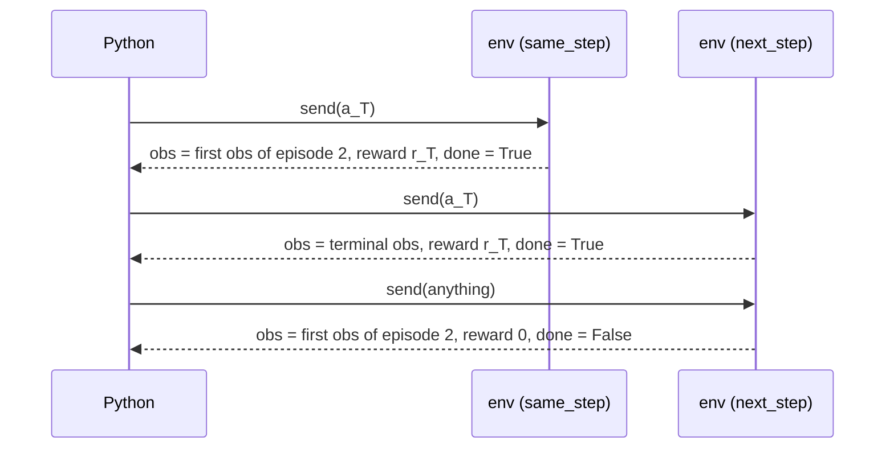

# Episodes and auto-reset

When an episode ends, the worker resets the environment by itself; you never call `reset` per
environment. The pool option `autoreset` chooses **which call returns the reset observation**.

| | `"same_step"` (default) | `"next_step"` (EnvPool's and gymnasium's convention) |
| --- | --- | --- |
| The terminal call returns | the **new** episode's first observation (and mask), the terminal reward, `done=True` | the **terminal** observation, the terminal reward, `done=True` |
| The next call for that env | a normal step of the new episode | the reset: its action is ignored; first observation, reward `0`, `done=False` |
| Calls per episode of `T` steps | `T` | `T + 1` |
| You never see | the terminal observation | nothing: every state is returned once |



Choose `same_step` for training loops (no wasted call per episode, and the GAE bootstrap is
simply cut at `done`). Choose `next_step` when you need the terminal observation, or when you
compare against EnvPool or gymnasium call for call.

```python
import numpy as np
import rustpool

def episode_lengths(autoreset, calls=300):
    pool = rustpool.make("CartPole-v1", num_envs=1, batch_size=1, seed=3, num_threads=1,
                         autoreset=autoreset)
    pool.async_reset()
    _, _, _, info = pool.recv()
    rewards, dones = [], []
    for _ in range(calls):
        pool.send(np.zeros(1, np.int32), info["env_id"])   # always push left: short episodes
        _, reward, done, info = pool.recv()
        rewards.append(float(reward[0]))
        dones.append(bool(done[0]))
    pool.close()
    return rewards, dones

r_same, d_same = episode_lengths("same_step")
r_next, d_next = episode_lengths("next_step")
# next_step spends one extra call per episode: reward 0, not done, right after each done.
after_done = [r for r, prev in zip(r_next[1:], d_next[:-1]) if prev]
assert after_done and all(r == 0.0 for r in after_done)
assert 0.0 not in r_same            # same_step never spends a call on the reset
print(sum(d_same), "episodes vs", sum(d_next), "in", len(r_same), "calls")
```

## Details

- `async_reset()` resets every environment and clears any pending reset, so the next `send`
  is a real step under either convention.
- The JAX bridge follows the pool's `autoreset`: `JaxPool("Maze-v0", 8, autoreset="next_step")`.
- `simulate_batch` (the search primitive) never auto-resets: a child whose step ends the
  episode is stored as the terminal state, with `done=True`. A search treats it as a leaf.
- CartPole-v1 has a single `done`: it does not separate termination from truncation.
