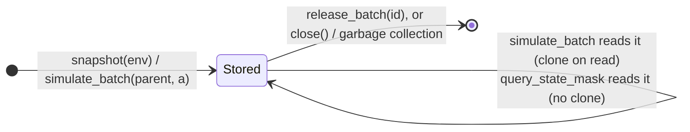

# State forks for search

A rollout steps each environment forward along one trajectory. A tree search (MCTS, AlphaZero)
needs more: from any node it has already visited, it must try an action, look at the result, and
come back to try another. A pool that only has `step` and `reset` over its *current* states
cannot do that. rustpool adds a **state registry** to the pool for it.

## The three calls

| Call | What it does |
| --- | --- |
| `snapshot(env_ids) -> list[int]` | Clone the current state of each live environment into the registry; return one integer `state_id` handle per env. No environment advances. |
| `simulate_batch(state_ids, actions) -> (obs, reward, done, info)` | For each pair: clone the stored state, apply the action, store the result as a **new** state. Returns outputs shaped like `recv`, with the children's handles in `info["state_id"]`. The parents are not modified. Runs in parallel (Rayon) with the GIL released. |
| `release_batch(state_ids)` | Free the given handles. Unknown or negative ids are ignored, so `-1` can mark unused slots. |

Because `simulate_batch` clones on read, one parent can be expanded any number of times, into
independent children: exactly the immutable-node semantics a search tree wants. Cloning an
environment clones its random generator too, so the same `(state_id, action)` always gives the
same child.

```python
import numpy as np
import rustpool

pool = rustpool.make("Maze-v0", num_envs=4, batch_size=4, seed=0)
pool.async_reset()
obs, _, _, info = pool.recv()

roots = np.asarray(pool.snapshot(info["env_id"]), np.int32)       # freeze the live states
a = np.full(4, 3, np.int32)
obs1, reward1, done1, child1 = pool.simulate_batch(roots, a)      # expand each root
obs2, reward2, done2, child2 = pool.simulate_batch(roots, a)      # again: same children
np.testing.assert_array_equal(obs1["agent_pos"], obs2["agent_pos"])
print(child1["state_id"], child2["state_id"])                      # four new handles each time

# Children are states too: expand them further.
grand = pool.simulate_batch(np.asarray(child1["state_id"], np.int32), a)[3]["state_id"]

pool.release_batch(np.asarray(grand, np.int32))
pool.release_batch(np.asarray(child1["state_id"], np.int32))
pool.release_batch(np.asarray(child2["state_id"], np.int32))
pool.release_batch(roots)
pool.close()
```

## Registry lifetime



- A handle lives until you release it, or until the pool is closed (`close()`, the end of a
  `with` block, or garbage collection), which frees every stored state; after that,
  `simulate_batch` and `query_state_mask` raise `RuntimeError` like every other call. A search
  creates a great many nodes: release the subtrees you prune, and the whole tree after each real
  step, or memory grows without bound.
- Handles are per pool. A released or unknown id is an error for `simulate_batch` and
  `query_state_mask`, and silently ignored by `release_batch`.
- The registry is independent of the live environments: stepping the pool does not change a
  stored state, and releasing a state does not touch the pool.
- There is no auto-reset in `simulate_batch`. A child whose step ends the episode is stored as
  the terminal state with `done=True`; a search treats it as a leaf.
- Under `autoreset="next_step"`, a snapshot taken after an episode's terminal step, before the
  call that resets it, holds the terminal state; `simulate_batch` steps it past the end of the
  episode. Treat such a node as a leaf too.
- `query_state_mask(state_ids, prefixes)` reads [factored masks](factored-actions.md) on stored
  states, so a search can expand nodes without the full action mask.

## Where it fits

On-device search libraries such as `mctx` fork a state by copying a JAX pytree, so they need the
environment (or a learned model) to be a JAX program. EnvPool has no clone primitive. rustpool
fills the gap for an **external simulator written in Rust**: the search can stay in JAX
(`mctx`) with the registry handle as its opaque embedding, while every expansion runs the real
environment code on the host.

The [AlphaZero example](../guides/training.md) drives `mctx` with `simulate_batch` as the
`recurrent_fn`. [The JAX bridge](jax-bridge.md) explains how those calls cross to the host.
