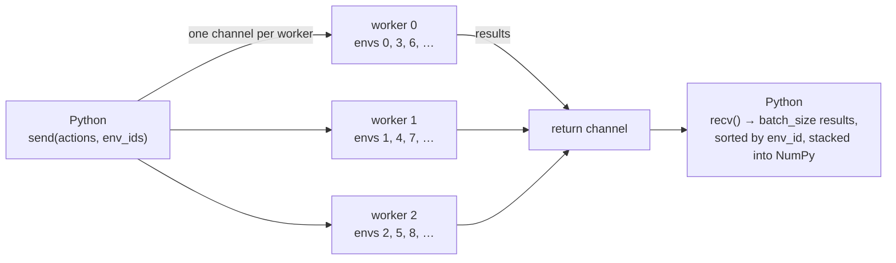

# The pool, threads and dispatch

A pool owns `num_envs` environments spread over `num_threads` Rust worker threads. Environment
`i` lives on worker `i % num_threads` for the pool's whole life. Python talks to the workers
through channels: `send` puts actions on them, and the workers put results on a shared return
channel that `recv` drains.



Workers are plain Rust threads: no Python object crosses the channels, and `recv` releases the
GIL while it waits. Observations are validated against the environment's
`observation_spec()` and stacked into NumPy arrays centrally, in `recv`.

## `num_envs`, `batch_size` and `num_threads`

| Option | Meaning |
| --- | --- |
| `num_envs` | Environments in the pool. |
| `batch_size` | How many ready environments `recv` waits for (`<= num_envs`). Equal to `num_envs`: synchronous. Smaller: asynchronous, `recv` returns whichever environments finish first. |
| `num_threads` | Worker threads. If omitted: the `RUSTPOOL_NUM_THREADS` environment variable, then the CPUs available to the process (it honours the cgroup quota and the affinity mask). Always capped at `num_envs`. |

```python
import rustpool

pool = rustpool.make("CartPole-v1", num_envs=6, batch_size=6, num_threads=4)
assert pool.num_threads == 4
pool.close()

small = rustpool.make("CartPole-v1", num_envs=2, num_threads=8)
assert small.num_threads == 2          # capped at num_envs: a third thread would own nothing
small.close()
```

Every pool spawns its own workers. A process holding several pools (one per GPU, say) should
split its CPUs between them with `num_threads`, or it will run `pools × CPUs` threads.

## Dispatch

`dispatch` decides how a `send` (and a `query_mask`) reaches the workers. Results are identical
in every mode; only the number of channel messages changes.

| `dispatch` | Messages per call | Best when |
| --- | --- | --- |
| `"per_env"` | one per environment each way | each worker gets about one row per call |
| `"per_worker"` | one per worker each way: the worker steps all its rows of the call, then returns their results together | many rows per worker (large batches, few threads) |
| `"auto"` (default) | `per_worker` when the call has more rows than there are workers, else `per_env` | almost always |

```python
import numpy as np

for mode in ("per_env", "per_worker", "auto"):
    pool = rustpool.make("CartPole-v1", num_envs=64, batch_size=64, num_threads=4,
                         dispatch=mode, seed=1)
    pool.async_reset()
    _, _, _, info = pool.recv()
    pool.send(np.ones(64, np.int32), info["env_id"])
    obs, reward, done, info = pool.recv()
    print(mode, pool.dispatch, obs["obs"][0])   # the same numbers in every mode
    pool.close()
```

## Validation and errors

Every check runs before anything reaches a worker, so a rejected call steps nothing and leaves
the pool usable.

| What went wrong | Exception | Example |
| --- | --- | --- |
| An unknown or mistyped environment option | `TypeError` | `make("Maze-v0", widht=3)` |
| An out-of-range option | `ValueError` | a maze of width 0, `num_envs=0` |
| An `env_id` outside `[0, num_envs)` | `IndexError` | `send(actions, [0, 99])`, `snapshot([-1])` |
| An unknown or released `state_id` | `ValueError` | `simulate_batch([released_id], ...)` |
| A shape or length mismatch, or a mask query on an env with no action factorization | `ValueError` | `query_mask` on `Maze-v0` |
| A closed pool | `RuntimeError` | any call after `close()` but `release_batch`, `close` and the specs |
| An array of the wrong dtype or kind | `TypeError` | `send(np.zeros(4, np.int64), ...)`: ids, actions and state ids are `int32` arrays, seeds `int64` |
| A negative size | `OverflowError` | `make("Maze-v0", num_envs=-1)` |

`make()` is more forgiving than the constructor: a missing, non-positive or oversized
`batch_size` becomes `num_envs` (EnvPool's behaviour), where `RlPool(...)` raises
`ValueError`. Action *values* are not checked: each environment decides what an out-of-range
action does (Maze treats it as an invalid move and ends the episode; CartPole pushes left for any
value but `1`; BinPack clamps a negative action to `0`).

`recv` waits for exactly `batch_size` results. Call it only when at least `batch_size`
environments have been sent (or reset) and not yet received: with fewer in flight it blocks
forever, and Ctrl-C does not interrupt it.

A pool you have closed raises `RuntimeError("environment pool has been closed")` instead of
crashing; `close()` also frees the stored search states. Use `close()` (or a `with` block) to
stop the workers promptly:

```python
with rustpool.make("Maze-v0", num_envs=4, batch_size=4) as pool:
    pool.async_reset()
    pool.recv()
    try:
        pool.send(np.zeros(2, np.int32), np.array([0, 99], np.int32))
    except IndexError as err:
        print("rejected:", err)
```

## Seeding

Environment `i` is built with seed `seed + i`, so a pool is reproducible from its `seed`.
`async_reset(seeds)` reseeds explicitly with one `int64` seed per environment;
`async_reset()` resets without reseeding, so each environment continues its own random
stream.
